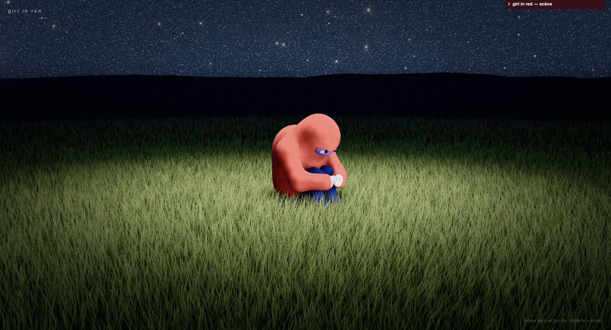

# girl in red — « . »



Un web visualizer en 3D du morceau **« . » de girl in red**, inspiré de son Spotify Canvas. La scène a été modélisée dans **Blender**, puis tourne en temps réel dans le navigateur avec **Three.js**.

[Le morceau sur Spotify](https://open.spotify.com/track/4r1AqGpB9YrXV2ivcrqfJY)

## Lancer le projet

```bash
npm install
npm run dev
```

## Technos

Blender · Three.js · GLSL · React · TypeScript · Vite

---

Projet de fan, non officiel. Le morceau et le visuel d'origine appartiennent à girl in red et à leurs ayants droit.
